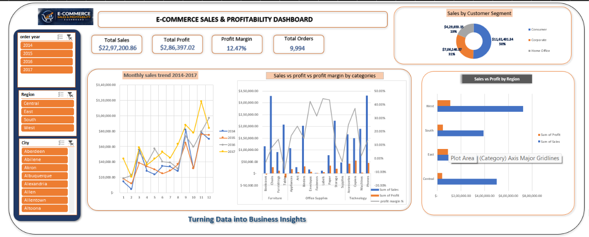

# E-Commerce Superstore Sales Analysis

## Project Overview
This project focuses on analyzing e-commerce sales data using Microsoft Excel.

## Tools Used
- Microsoft Excel
- Pivot Tables
- Pivot Charts
- Slicers
- Data Visualization

## Project Files
- `E-Commerce-Superstore-Sales-Analysis.xlsx` – Complete Excel analysis and dashboard.
- `Sample - Superstore.csv` – Original dataset.
- `E-Commerce-Superstore-Sales-Profitability-Report.docx` – Project report.

## Analysis
- Sales and profit analysis
- Regional performance
- Customer segment analysis
- Monthly sales trends
- Product profitability
- Discount impact on profit

## Objective
To analyze sales performance, identify business trends, and generate meaningful insights from the data.

